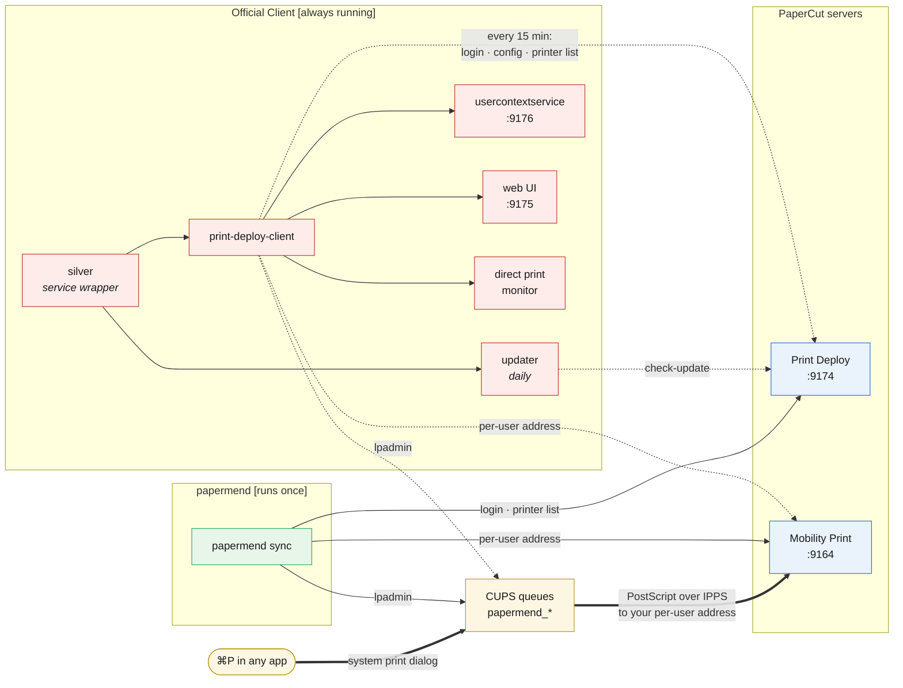

# papermend

A minimal PaperCut Print Deploy client for macOS and Linux. Print drivers are installed mimicking how the official
client works, but without background processes, web portal, self-updater, telemetry, job-tracking, or requirement for 
Rosetta on Apple Silicon - a common, opaque failure case.

> [!IMPORTANT]
> This tool was originally built for PaperCut Print Deploy at Imperial College; it is not affiliated with
> PaperCut or Imperial College (in fact, it was built out of frustration at the former). Other setups should work, but 
> are not tested.

## Usage

| Install  | Command                                                        |
|----------|----------------------------------------------------------------|
| Homebrew | `brew install lancylot2004/tap/papermend`                      |
| Prebuilt | `cargo binstall papermend`                                     |
| Source   | `cargo install papermend`                                      |
| Manual   | [Releases](https://github.com/lancylot2004/papermend/releases) |
| deb, rpm | [Releases](https://github.com/lancylot2004/papermend/releases), then `dpkg -i` / `rpm -i` |

Installing never needs root. Running `sync` needs an admin account (macOS) or membership of the
`lpadmin` group (Linux), because CUPS gates queue changes on it.

```sh
papermend status            # Current status.
papermend sync              # Sign in and install printers.
papermend sync --printer Canon-Colour --printer Canon-Mono
                            # Name printers yourself to bypass frequent PaperCut failures:
                            # these are the two virtual printers at Imperial College.
papermend remove            # Remove every queue papermend installed.
```

## Platforms

- **macOS:** Tested.
- **Linux:** Builds, but not tested.
- **Windows:** Not supported (yet). Windows does not use CUPS.

| Option       | Env                  | Default                                   |
|--------------|----------------------|-------------------------------------------|
| `--server`   | `PAPERMEND_SERVER`   | `https://icl-print-service.ic.ac.uk:9174` |
| `--username` | `PAPERMEND_USERNAME` | None; required.                           |
| `--timeout`  | `PAPERMEND_TIMEOUT`  | `30` seconds per request                  |

## Behaviour

These aren't necessary to understand to use the tool. The official client and papermend talk to
the same two servers and configure the same CUPS queues; the difference is what runs, and for
how long:



Dashed arrows recur in the background; solid run once per invocation; thick is the path your
print job takes.

- Managed queues are named `papermend_<server name>`; all else is ignored. This means that `papermend` holds no state of
  its own.
- Each Mobility Print queue's device URI is a per-user address (`ipps://…/printers/<name>/users/<user>/<token>`), looked
  up with the user's password during `sync`. This means that you **should not install `papermend` on shared accounts**,
  since anyone with these links can print as you.
- Jobs are rendered locally by the OS's generic PostScript driver, because Mobility Print passes documents through
  untouched and silently drops PDF. Vendor finishing options (stapling, punching) are unavailable. Big sad.
- `sync --printer` makes the named Mobility queues the whole desired list and skips Print Deploy entirely - the per-user
  lookup authenticates on its own. Other managed queues are removed.
- Direct-print queues are refused (they are only accounted for by PaperCut's local job tracking, which papermend
  deliberately lacks); optional self-service queues are skipped.
- The server sees your username, IPv4 addresses (its zones pick printers by them), client version, and OS name, version,
  and architecture. Hostname and directory domain are sent empty, and TLS is always verified.

> [!IMPORTANT]
> The Print Deploy API is private: endpoints and wire shapes were reverse-engineered from the
> official client (see `src/api/model.rs`) and verified only against Imperial's servers.
> OAuth/SSO login and PaperCut driver bundles are not implemented.
